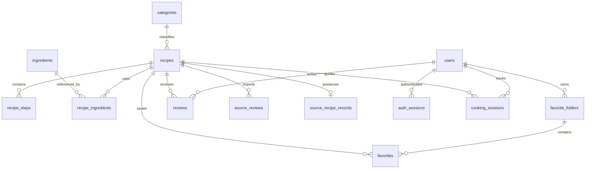

# 数据库结构与验证记录

## 数据库和连接

默认数据库 data/recipe_platform.db。独立 SQLite CLI 执行规范 CSV 导入，DB Browser 管理同一文件，后端 Python sqlite3 驱动按请求创建连接并在结束时关闭，显式启用外键。相对 APP_DB_PATH 统一相对于项目根目录。WAL、15 秒超时用于基础并发控制。

## ER 关系



## 函数依赖与规范化

recipes.id 决定标题、描述、分类 ID、时长、状态等属性；categories.id 和 categories.name 都是候选键，分类名称只在分类表保存，避免分类改名引发更新异常。ingredients.name 是候选键，食谱与食材的多对多关系通过 recipe_ingredients 拆分。

(recipe_id, position) 决定步骤内容；在食材关系表中决定 ingredient_id 与 quantity。不能把重复出现的同一种食材合并，否则可能丢失来源顺序。收藏以 (folder_id, recipe_id) 唯一，本地评价以 (user_id, recipe_id) 唯一。上述核心业务关系以 3NF 为设计目标；raw_json 与 nutrition_json 为来源审计和未规范化展示数据，不声明其满足原子字段要求。后续若需要按营养筛选，应拆成有单位和口径约束的业务字段。

来源评论与本站评价分表；source_author_id 不映射为本站账户。来源 0 分保存在 raw_rating 中，rating 设 NULL，不参与均分。来源营养单位不推断，来源评分和本站均分不混算。孤儿评论进入 quarantined_reviews，不禁用外键强行导入。

## SQL 与关系代数

```sql
SELECT r.id, r.name, c.name AS category_name
FROM recipes r JOIN categories c ON c.id=r.category_id
WHERE r.status='published';

SELECT recipe_id, COUNT(rating), AVG(rating)
FROM reviews GROUP BY recipe_id HAVING COUNT(rating)>0;

SELECT r.id FROM recipes r
WHERE NOT EXISTS (SELECT 1 FROM reviews v WHERE v.recipe_id=r.id);
```

第一条对应投影 π(id,name,category_name)、选择 σ(status='published') 和 recipes 与 categories 的等值连接。计数、分组、连接和反连接对应课程 SQL 内容；主键、外键、UNIQUE、NOT NULL 和 CHECK 对应实体、参照与域完整性。

## 迁移、索引、触发器与事务

001_initial.sql 创建核心业务关系；002_features.sql 添加时长、来源快照、会话、烹饪记录、导入审计和 FTS5。schema_migrations 记录已执行版本。迁移与导入合并均在显式事务中执行，失败不留下半批数据；准备 CSV 阶段不会修改业务记录。

FTS5 的插入、更新和删除触发器维护名称索引，查询参数构造成带引号的词组避免任意 FTS 表达式。分类、状态/时长、关联外键和用户进度有索引。后续仍需测量全量并发、P95 延迟及锁竞争，不以简单本地检查代替课程性能报告。

进度通过 version 字段乐观锁防止不同页面覆盖；终态 completed/cancelled 不能再回到进行中。权限在后端验证，收藏/评价/进度只能操作本人数据，管理员接口验证 role。密码使用带随机盐的 PBKDF2，HttpOnly 会话 Cookie 和服务端会话哈希支持退出撤销。所有写请求要求同源及 X-Requested-With 校验头。

## 已执行的基础验证

100 条真实食谱及 815 条对应来源评论的独立测试库导入成功。33 项 HTTP 冒烟检查覆盖：健康、搜索、非法分页、详情、未登录拒绝、注册冲突、重复收藏幂等、非法评分、本地评价更新与删除、烹饪状态保存、过期版本冲突、终态保护、跨用户资源隔离、普通用户管理权限拒绝、退出撤销和重新登录后的记录保留。JavaScript 语法检查通过。

脚本 scripts/smoke_test.py 使用标准库 urllib，无需额外测试依赖。必须对独立测试库运行，脚本会创建测试账户和烹饪记录；不要对成员正式使用的数据库运行。可用 --base 指定服务地址。

此记录不代表完整产品验收、全量压力测试或生产安全审核。详细全量计数和完整性结果见本地 data/prepared/import_report.json。

## 本次全量验证结果

全量导入已完成：522,517 道食谱、1,401,963 条来源评论、7,309 个食材名称；19 条孤儿评论隔离。PRAGMA integrity_check 返回 ok，foreign_key_check 无违规。实际完整数据库 API 查询 chicken 且总时长不超过30分钟，返回13,965条候选，详情可读取食材、步骤和来源评论。管理员导入记录查看、下架后详情不可见、重新发布，以及缺少写请求校验头被拒绝，均已另行验证。

407,532 条来源食谱的食材和用量列表长度不一致，按保守策略展示未知用量并保留完整原文。该数字是来源质量统计，不表示解析失败；本次 recipe_errors 为0。
